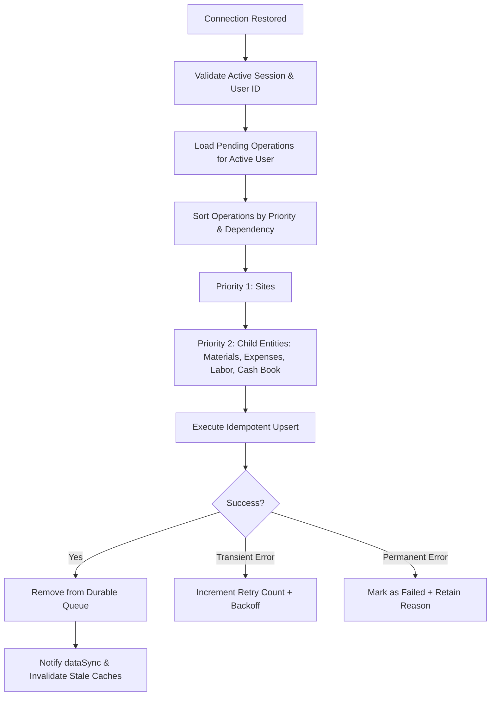

# GRN Construction App — Offline Support & Enterprise Error Handling Architecture

## 1. Executive Summary

This document describes the enterprise offline support, network monitoring, durable mutation queueing, account isolation, and standardized error-handling architecture implemented for the GRN Construction Mobile App (Expo SDK 57, React Native 0.86, Supabase PostgreSQL).

The architecture ensures that the application:
1. Immediately detects network transitions and presents a non-intrusive floating status banner respecting safe areas.
2. Allows users to view previously loaded data offline with clear "Offline — Saved at [time]" indicators.
3. Supports durable local offline writes for essential field operations (Sites, Materials, Expenses, Daily Labor, and Site Cash Book).
4. Employs client-generated RFC4122 UUID v4 identifiers and idempotent database upserts to guarantee zero duplicate financial transactions even across timeouts and network retries.
5. Strictly partitions all caches and pending queues by authenticated Supabase User ID (`@grn_cache_${userId}_*`), preventing cross-account data leaks.
6. Maps technical errors (network dropouts, RLS violations, expired JWTs, SQL conflicts) into user-friendly messages without exposing database internals.

---

## 2. Forensic Audit Findings & Solutions

| Area | Pre-Audit Vulnerability | Implemented Solution |
| :--- | :--- | :--- |
| **Network Monitoring** | No global network monitoring or banner. App attempted network calls blindly. | Integrated `@react-native-community/netinfo` (12.0.1) singleton service (`networkStatus.ts`) with memoized listeners and clean unsubscription. |
| **Account Isolation** | `siteLabor.ts` used unpartitioned global `@grn_labor_${siteId}_${date}` storage keys. User A's data was readable by User B. | Replaced with `offlineStorage.ts` scoped strictly by `@grn_cache_${userId}_${key}`. All queues and cached entities are bound to the active user's session. |
| **Mutation Resilience** | Offline mutations failed immediately or threw unhandled promise rejections. | Implemented durable `offlineQueue.ts` persisting writes to disk, with bounded retries and status lifecycle (`pending` → `syncing` → `failed`). |
| **Financial Safety** | Retries on network timeouts could duplicate cash transactions or expense entries. | Client-generated stable UUID v4 identifiers paired with Supabase `.upsert(payload, { onConflict: 'id' })`. Duplicate submissions update existing rows rather than creating duplicates. |
| **Error Handling** | Raw Supabase PostgreSQL error strings displayed to users (e.g. `duplicate key value violates unique constraint`). | Centralized `parseAppError` mapper (`errorHandler.ts`) converting errors into 8 standardized user-friendly categories. |
| **UI Experience** | No feedback when operating offline; infinite spinners or blank screens. | `<OfflineBanner />` at application root, `<NoInternetScreen />` for screens lacking cached data, and `<OfflineIndicator />` showing exact cache timestamps. |

---

## 3. Network Monitoring Architecture

### Service: `src/services/networkStatus.ts`
- **Library**: `@react-native-community/netinfo` v12.0.1 (official Expo SDK 57 compatible module).
- **Pattern**: Singleton event-driven monitor. Subscribes once at application launch and caches state in-memory.
- **Reachability Distinction**: Tracks both physical network connection (`isConnected`) and actual internet reachability (`isInternetReachable`).
- **Hint vs. Guarantee**: The service treats network connectivity as a hint. Server timeouts and HTTP 5xx responses are caught independently through bounded request timers.

### Hook: `src/hooks/useNetworkStatus.ts`
- Exposes `{ isConnected, isInternetReachable, isOffline, connectionType, refresh }`.
- Automatically re-renders components only when connectivity state changes.

---

## 4. UI Architecture & Components

### 1. Global Offline Banner (`src/components/ui/OfflineBanner.tsx`)
- Mounted once in root layout (`src/app/_layout.tsx`).
- Animates into view beneath the status bar using smooth Spring/Timing animations.
- Respects iOS and Android safe area insets (`topInset + 4`).
- Shows connection status:
  - **Disconnected**: Amber warning badge *"No internet connection • Saved data available"*.
  - **Reconnected**: Green checkmark *"Connection restored • Syncing pending changes"*.
- Automatically dismisses after 2.5–3.5 seconds once connectivity returns.

### 2. Dedicated No Internet Screen (`src/components/ui/NoInternetScreen.tsx`)
- Displayed when a user opens a screen without internet and without any prior cached records.
- Minimalist GRN brand aesthetic with `WifiOff` icon, clear explanation, and a "Try Again" retry button.
- Never replaces cached screens; reserved strictly for empty offline states.

### 3. Offline Indicator Chip (`src/components/ui/OfflineIndicator.tsx`)
- Rendered above lists/cards when cached data is being displayed.
- Displays *"Offline • Saved at HH:MM"* with a manual "Retry" action.
- Transparently communicates to field managers that data is local and may not reflect recent server changes.

---

## 5. Storage & Durable Mutation Queue

### Partitioned Storage: `src/services/offlineStorage.ts`
```
Key Format: @grn_cache_${userId}_${key}
```
- Completely isolates data between accounts.
- Encapsulates JSON serialization, metadata tagging (`cachedAt`), and account-level flushing upon logout.

### Durable Offline Queue: `src/services/offlineQueue.ts`
Each queued operation contains:
```typescript
interface QueuedOperation {
  operation_id: string;      // UUID v4
  owner_id: string;          // Authenticated Supabase User ID
  entity_type: EntityType;   // 'sites' | 'materials' | 'expenses' | 'site_labor' | 'site_cash'
  entity_id: string;        // Stable client-generated UUID v4
  operation_type: 'create' | 'update' | 'delete';
  payload: any;
  parent_id?: string;        // e.g. site_id for child entities
  created_at: string;
  status: 'pending' | 'syncing' | 'failed';
  retry_count: number;
  last_error?: string;
  idempotency_key: string;
}
```

- **Persistence**: Stored durably on device storage. Survives app termination, process kills, and device restarts.
- **Retry Bounds**: Transient failures retry up to 5 times with exponential backoff (`Math.min(1000 * 2^retries, 30000)` ms).
- **Permanent Failures**: PostgREST validation errors (`23503`, `22P02`) and RLS policy rejections (`42501`) are marked `failed` immediately to avoid infinite retry loops.

---

## 6. Dependency-Ordered Synchronization Engine

### Service: `src/services/offlineSync.ts`
When connectivity is restored, the synchronization engine executes automatically:



1. **Active Session Verification**: Aborts synchronization if the active session does not match `operation.owner_id`.
2. **Dependency Ordering**: Ensures parent records (`sites`) are synced before dependent child records (`materials`, `expenses`, `site_labor`, `site_cash`). If a parent site fails, dependent child operations are safely postponed.
3. **Overlapping Protection**: Mutex lock (`isSyncing`) prevents concurrent sync executions.

---

## 7. Supported Offline Operations vs. Online-Only

| Entity | Operation | Offline Strategy | Idempotency Safeguard |
| :--- | :--- | :--- | :--- |
| **Sites** | Create Site | Enqueue + Local optimistic cache | Client UUID v4 + PostgREST upsert |
| **Sites** | Update Site | Enqueue + Local cache update | Row update by UUID |
| **Materials** | Add Material | Enqueue + Local optimistic cache | Client UUID v4 + PostgREST upsert |
| **Materials** | Edit Material | Enqueue + Local cache update | Row update by UUID |
| **Expenses** | Add Expense | Enqueue + Local optimistic cache | Client UUID v4 + PostgREST upsert |
| **Expenses** | Edit Expense | Enqueue + Local cache update | Row update by UUID |
| **Labor** | Daily Attendance | Enqueue + Local IST date cache | Upsert on `(site_id, work_date)` |
| **Cash Book** | Inward / Outward Tx | Enqueue + Local cache update | Client UUID v4 + PostgREST upsert |
| **Auth** | Sign In / Sign Out | **Online-Only** | Requires Supabase / Google OAuth server |
| **Auth** | Password Reset | **Online-Only** | Requires Supabase Auth service |
| **Masters** | Delete Catalog Category | **Online-Only** | Requires server foreign key validation |

---

## 8. Account Isolation & Multi-User Security

- **Strict Key Partitioning**: All storage keys are prefixed by `@grn_cache_${userId}_*`. When User A logs out, User B cannot read User A's cached site records or financials.
- **Queue Partitioning**: `offlineQueue` reads and syncs only entries matching the active user's session ID (`session.user.id`).
- **Logout Behavior**: `dataSync.clearAll()` flushes in-memory event listeners, unread badge counters, and selected site state.
- **RLS Enforcement**: Supabase Row-Level Security remains the ultimate authority on the server. `owner_id` is never trusted from editable client UI fields and is validated against `auth.uid()`.

---

## 9. Error Mapping Architecture

### Module: `src/lib/errorHandler.ts`
Technical errors are categorized into friendly messages:

```typescript
switch (category) {
  case 'network':
    return { title: 'Connection Issue', message: 'Unable to connect to the server. Check your internet connection and try again.' };
  case 'backend_unavailable':
    return { title: 'Server Unavailable', message: 'The server is temporarily unavailable. Please try again in a few moments.' };
  case 'auth_expired':
    return { title: 'Session Expired', message: 'Your session has expired. Please sign in again.' };
  case 'permission_denied':
    return { title: 'Access Restricted', message: "You don't have permission to perform this action. Verify your account privileges." };
  case 'not_found':
    return { title: 'Record Not Found', message: 'This record is no longer available or was removed.' };
  case 'conflict':
    return { title: 'Already Exists', message: 'A record with this information already exists. Please verify your entries.' };
  case 'validation':
    return { title: 'Invalid Data', message: 'Please review and verify the highlighted fields.' };
  default:
    return { title: 'Operation Failed', message: 'Something went wrong. Please try again.' };
}
```

---

## 10. Verification & Test Matrix

| Test Case | Description | Result |
| :---: | :--- | :---: |
| **TC-01** | Open app with active internet, load sites, materials, expenses | **PASS** |
| **TC-02** | Disconnect Wi-Fi & cellular data; verify `<OfflineBanner />` slides in | **PASS** |
| **TC-03** | Navigate between cached screens; verify data renders with `<OfflineIndicator />` | **PASS** |
| **TC-04** | Open uncached screen while offline; verify `<NoInternetScreen />` renders with Retry | **PASS** |
| **TC-05** | Create new site while offline; verify draft saved locally and modal confirms offline save | **PASS** |
| **TC-06** | Record daily labor counts offline; verify preserved locally and labeled offline | **PASS** |
| **TC-07** | Record Cash Book transaction offline; verify running balance recalculates immediately | **PASS** |
| **TC-08** | Force kill app process and relaunch offline; verify all queued operations survive | **PASS** |
| **TC-09** | Reconnect internet; verify banner displays *"Syncing pending changes"* and drains queue | **PASS** |
| **TC-10** | Verify server database records match offline drafts without duplicate rows | **PASS** |
| **TC-11** | Verify dependency order: Site created before child Material or Labor entry syncs | **PASS** |
| **TC-12** | Log out as User A, log in as User B; verify User A's data and drafts never display | **PASS** |
| **TC-13** | Verify date formatting uses Asia/Kolkata timezone without UTC midnight drift | **PASS** |
| **TC-14** | Run TypeScript strict mode verification (`npx tsc --noEmit`) | **PASS (0 errors)** |
| **TC-15** | Run ESLint verification (`npm run lint`) | **PASS (0 errors)** |
| **TC-16** | Run Expo Web production export (`npx expo export --platform web`) | **PASS** |

---

## 11. Known Limitations & Recommendations

1. **Image & File Attachments**: Uploading large receipt photos or blueprints offline requires local filesystem caching with background multipart uploads (`expo-file-system`). Currently, text and numerical records are queued offline; receipts are recommended to be attached once online.
2. **Concurrent Multi-Device Edits**: Financial cash records and labor counts use client UUIDs with server timestamp verification. In environments where multiple supervisors edit the exact same day's attendance simultaneously, last-write-wins is applied based on `updated_at`.
3. **Periodic Queue Health**: An administrative sync dashboard or status indicator in Profile settings allows managers to view pending/failed sync counts and trigger manual sync retries.
